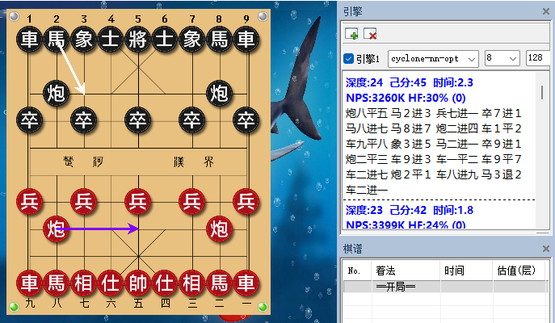
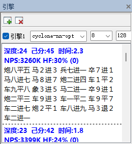

# 象棋旋风破解器

适配版本：**10.01 旗舰版**。三版本助手分别对应原包中的 **OPT、COM、MAX**，棋盘通过 UCI 加载对应原 EXE。**支持配置旋风审局库（残局库）**。

[使用说明](#使用说明) · [界面截图](#界面截图) · [审局库配置](#审局库配置) · [原理说明](#原理说明) · [源码与构建](src/README.md)

## 下载包

本项目提供单独版与鲨鱼整合包两种形式。公开发布已撤回，仓库保持私有。程序包、离线源码包与校验文件保留在私有 Release 中，暂停对外下载。

| 下载包 | 内容与用途 | 当前状态 |
| --- | --- | --- |
| 单独版 | 三版本助手及使用说明；适合已有原引擎和棋盘的用户 | 已撤回公开发布 |
| 鲨鱼象棋＋旋风整合包（手动预览版） | 鲨鱼棋盘、旋风三原引擎、NNUE 与两个助手 | 已撤回公开发布；需要分别启动助手，尚未完成整包运行验证 |

单独版不含原引擎、NNUE 模型、审局库或鲨鱼棋盘。下载包放在 Releases 的附件区域。

## 源码与构建

旋风助手的 C# 控制器、Python 运行层及组件清单已放在 [`src/`](src/README.md)，构建步骤见 [`src/BUILD.md`](src/BUILD.md)。这是助手源码，原引擎本体的源码不在其中。

完整离线源码包 `Cyclone-Cracker-10.01-Ultimate-Helper-Source.zip` 同时携带三个预编译运行组件，已撤回公开发布。GitHub 自动生成的 Source code ZIP 只包含仓库文件。

鲨鱼启动器源码已在 [鲨鱼启动器项目](https://github.com/tippingabke-gif/chessshark-portable-launcher)发布，本次旋风源码包不重复收录。第三方组件保留各自许可证。

## 使用说明

### 单独版启动

1. 完整解压单独版，将 **象棋旋风破解器.exe** 放到原引擎文件夹。
2. 检查所需原 EXE 与 **cyclone-eval.nnue** 是否齐全。只启用需要的版本即可。
3. 打开助手，按 Windows 提示确认管理员权限，等待辅助文件准备完成。
4. 点击所需版本的“启用”。显示“已启用”后，在鲨鱼等棋盘中添加该行对应的原 EXE，协议选择 **UCI**。
5. 点击棋盘的放大镜开始计算。加载时等待初始化完成，避免反复加载同一版本。
6. 使用结束时先停止计算、卸载引擎连接，再停止或关闭助手。

**每次使用都需要打开并保持助手运行。** 移动文件夹前先结束计算与助手；下次从新位置打开助手，并更新棋盘中的引擎路径。

### 整合包启动（手动预览版）

1. 完整解压整合包，保留“鲨鱼”和“旋风”两个子文件夹的相对位置。
2. 打开 `旋风/象棋旋风破解器.exe`，启用 OPT 并等待显示“已启用”。
3. 打开 `鲨鱼/ChessShark_便携启动修复.exe`，由鲨鱼助手启动棋盘。
4. 棋盘预设包内 OPT 相对路径。若路径提示错误，重新选择 `旋风/cyclone-nn-opt.exe`，协议使用 UCI。
5. 点击放大镜计算，期间保持两个助手运行；结束时先退出棋盘，再关闭助手。

本包为手动启动预览版，当前需分别打开两个助手。整包运行尚待验证，使用步骤也随 ZIP 提供。

### 三版本选择

| 版本 | 棋盘加载的原文件 | 选择建议 |
| --- | --- | --- |
| OPT | `cyclone-nn-opt.exe` | 优先尝试 |
| COM | `cyclone-nn-com.exe` | 需要兼容版本时尝试 |
| MAX | `cyclone-nn-opt-max.exe` | 已在虚拟机完成加载和计算验证；其他环境需单独验证 |

使用环境为 Windows 10/11 x64，完整解压到可写目录。三个版本对应不同原文件；更改文件名不会改变实际版本。

### 常见情况

- **未找到文件**：检查助手是否与原 EXE 同目录，是否完整解压。
- **原文件或模型校验失败**：检查是否为对应 10.01 旗舰版文件，避免混用不同包的模型。
- **已有助手正在运行**：保存棋局并退出原会话，再启用新助手。
- **加载超时**：确认对应版本已启用、旧引擎连接已释放，再重新加载一次。
- **关闭助手后**：本次启动接管恢复，按程序设置的外网阻止规则保留。

## 界面截图

### 1. 在助手中启用所需版本


三版本助手主界面。OPT 已启用，可在棋盘中加载对应原 EXE。

### 2. 在鲨鱼中计算



OPT 引擎在鲨鱼象棋中的计算界面。

### 3. 计算信息局部



上图计算信息的局部放大。

## 审局库配置

**可以使用旋风审局库。** 审局库由用户自行准备，在原引擎旁的 `config.ini` 中设置 `TB_Path`。以下为示例目录，请换成自己的库目录：

```ini
TB_QuickMove = true
TB_ProbeDepth = 12
TB_Path = D:\CycloneTables
```

修改前退出引擎，保留配置文件原有编码。保存后重新启用助手并加载引擎。

- `find evtb count` 大于零：引擎找到了库文件。OPT 已观察到这一行为。
- `tbhits`：用于判断适用残局是否实际命中查表；开局局面可能为零。
- `TB_QuickMove`：查库快速出招选项。
- `TB_ProbeDepth`：查库探测深度选项，具体效果由原引擎实现决定。

`cyclone-eval.nnue` 是神经网络评估模型，需与引擎同目录；审局库是额外的残局数据，二者互不替代。识别到库文件不代表每个局面都已命中查表。

## 原理说明

### 原文件与运行组件

助手先核验对应引擎、NNUE 与运行组件，再展开自身携带的辅助文件。原引擎 EXE 和 `cyclone-eval.nnue` 保持原有内容，三个版本分别处理。

### 棋盘如何接入

启用时，助手为所选原 EXE 的完整路径建立临时启动接管，并记录本次会话和原状态。棋盘按原路径启动引擎时，辅助程序接入运行链，完成启动处理与 UCI 输入输出转发。计算期间需要保持助手运行。

OPT、COM 使用各自的启动流程，MAX 使用兼容执行链连接真实引擎与棋盘。虚拟机中完成加载和计算验证，不等于所有本机环境的兼容性或原生性能均已验证。

### 初始化与计算输出

现有运行处理涉及初始化状态，以及影响棋规和评估的部分表数据。启动握手、棋规、评估与协议转发是不同环节。棋盘收到的搜索分数、走法和 NPS 来自引擎输出；助手不生成这些搜索结果。现有验证未形成与厂商授权版本棋力完全等价的结论。

### NNUE、审局库与退出

NNUE 由原引擎用作评估模型；审局库由原引擎按 `config.ini` 中的 `TB_Path` 读取。助手不代替引擎判断具体局面是否命中查表。

运行链使用按程序设置的外网阻止规则。正常停止时，助手结束对应会话并恢复本次创建的启动接管，网络阻止规则保留。当前为每次运行助手的方式。

项目地址：https://github.com/tippingabke-gif
